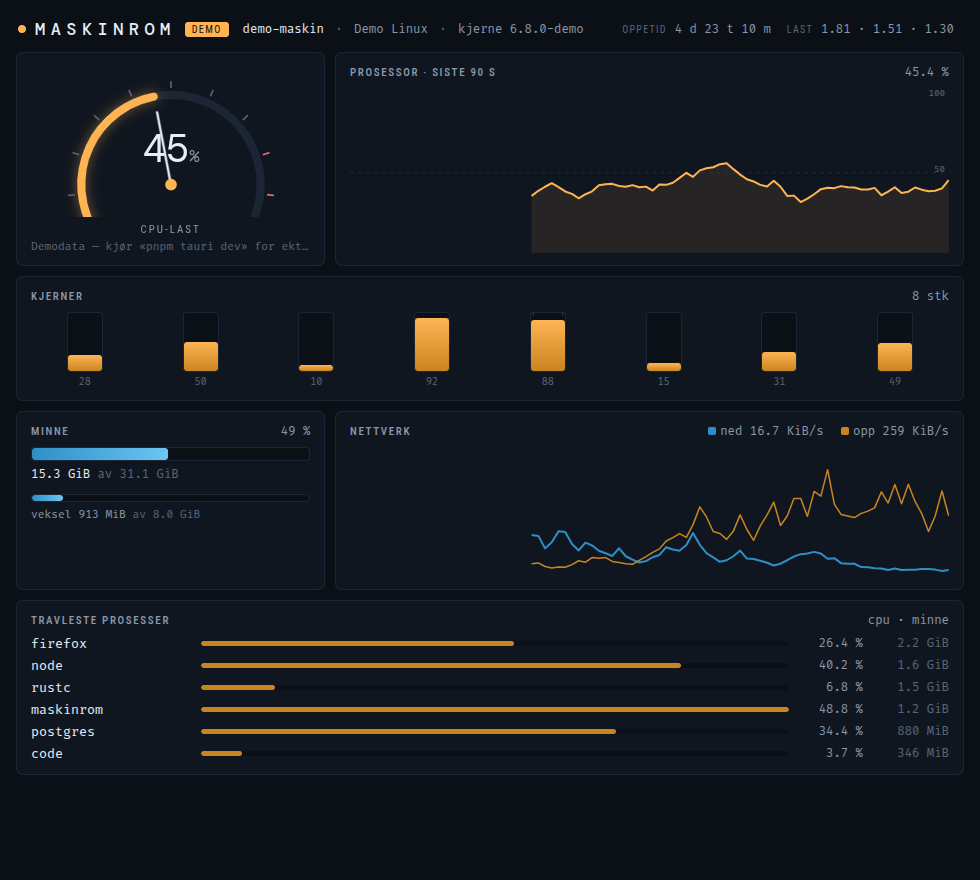

# Maskinrom 🎛️

Sanntids systemmonitor bygget med [Tauri 2](https://tauri.app), [SvelteKit](https://svelte.dev) (Svelte 5) og Rust.

En Rust-tråd samler systemdata hvert sekund med [`sysinfo`](https://crates.io/crates/sysinfo) og streamer dem til webviewen som Tauri-events. Frontenden tegner alt selv med SVG og CSS — ingen chart-biblioteker.



## Hva den viser

- **CPU-last** som maskintelegraf-gauge med nål, pluss 90 sekunders historikk med crosshair-tooltip
- **Per-kjerne-søyler** for alle CPU-kjerner
- **Minne og veksel** (swap) med målere
- **Nettverkstrafikk** ned/opp som graf
- **Travleste prosesser** med CPU og minne
- Oppetid, load average, vertsnavn, OS og kjerneversjon i toppen

Kjøres frontenden uten Tauri (ren `pnpm dev` i nettleser) går den i **DEMO**-modus med generert data. I selve appen står det **SANNTID**.

## Kjøring

Krever [Tauri sine Linux-avhengigheter](https://tauri.app/start/prerequisites/), bl.a. `libwebkit2gtk-4.1-dev`.

```sh
pnpm install
pnpm tauri dev     # utviklingsmodus med ekte systemdata
pnpm tauri build   # ferdig binær/pakke
```

## Hvordan det henger sammen

- `src-tauri/src/lib.rs` — Rust-tråden som samler og emitter `stats`-events
- `src/routes/+page.svelte` — hele dashbordet: gauge-geometri, sparklines, målere og demo-generator

Fargeparet i grafene (blå/rav) er validert for fargeblindhet og kontrast mot mørk bakgrunn.
